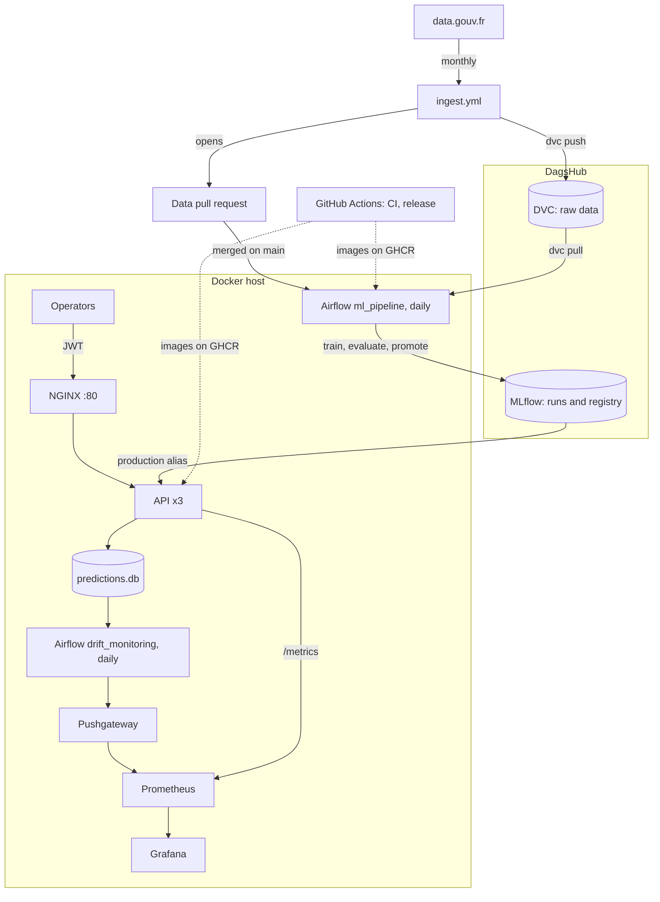

# Road Accident Severity Prediction (BAAC)

MLOps project predicting, for each person involved in a road accident in France,
whether they are **severely injured** (killed or hospitalized) or not, from the
public [BAAC dataset](https://www.data.gouv.fr/datasets/53698f4ca3a729239d2036df/).
The focus is the MLOps lifecycle (versioned data, tracked training, quality
check before production, serving, monitoring, automatic updates) rather than
model performance.

- **Data:** BAAC 2019-2024, ~596,000 road users, one row per person.
- **Model:** XGBoost, decision threshold 0.35 to favour recall: an emergency
call centre would rather over-flag than miss a severe case.
- **Results on the test set:** AUC 0.876, recall 0.896, precision 0.38.


## Architecture




| Component         | Role                                                                                                               |
| ----------------- | ------------------------------------------------------------------------------------------------------------------ |
| `src/data/`       | Ingestion from data.gouv.fr, merge of the 4 BAAC tables, target, grouped train/test split                          |
| `src/training/`   | Training, evaluation, and the metric check before production (`promote.py`)                                        |
| `src/api/`        | FastAPI service: JWT auth, `/predict`, prediction log, Prometheus metrics                                          |
| `src/monitoring/` | Drift detection (Evidently), and a script sending real accidents to the API to simulate traffic                    |
| `dags/`           | Airflow: `ml_pipeline` (retraining) and `drift_monitoring`                                                         |
| `deployment/`     | NGINX, Prometheus and Grafana configuration, including the dashboard                                               |
| `docker/`         | Three images: `api`, `training` (every batch job: preprocessing, training, evaluation, promotion, drift) and `dvc` |


## Quick start

Requirements: Docker with Compose, [uv](https://docs.astral.sh/uv/), and a
DagsHub account with access to the repository (data and models live there).
On macOS, XGBoost needs `brew install libomp`.

First time on a machine:

```bash
git clone https://github.com/hkayne1987/may26_cmlops_accidents.git
cd may26_cmlops_accidents
make setup                                    # uv sync, creates .env from env.example
# fill in .env: DagsHub user and token, JWT_SECRET_KEY, API_PASSWORD
make data                                     # pull the raw data (DVC), preprocess it
make users ARGS="create <name> --role admin"
make users ARGS="create airflow_service --role service"   # password = API_PASSWORD
```

Then:

```bash
make update      # after a merge: git pull + latest published images
make up          # API behind NGINX, Prometheus, Pushgateway, Grafana
make health      # check the API is up, and which model version it serves
make replay      # send real accidents to the API (SCENARIO=motorway to make them drift)
make drift       # drift check, result in Grafana
make airflow     # optional, then make airflow-password for the admin login
make down        # stop everything, data kept
```


| Service         | URL                                                                                  | Login                             |
| --------------- | ------------------------------------------------------------------------------------ | --------------------------------- |
| API and Swagger | [http://localhost](http://localhost), [http://localhost/docs](http://localhost/docs) | API account                       |
| Grafana         | [http://localhost:3000/d/baac-api](http://localhost:3000/d/baac-api)                 | `admin` / `GRAFANA_PASSWORD`      |
| Prometheus      | [http://localhost:9090](http://localhost:9090)                                       | none                              |
| Airflow         | [http://localhost:8080](http://localhost:8080)                                       | `admin` / `make airflow-password` |


`make help` lists every target. `make clean-state` erases what the stack
recorded (metrics, Airflow history, drift reports, logged predictions);
`make clean-images` removes the images. Neither touches data, models or accounts.

## Data

Only the raw CSVs are versioned, with DVC on DagsHub: Git carries their hash in
`data/raw.dvc`. `make data` pulls them, then rebuilds `data/processed/`
(`train.parquet`, `test.parquet`) from them; the processed files are never
versioned. The column meanings are in
`docs/description-des-bases-de-donnees-annuelles.pdf`.

Preprocessing choices:

- **2019 onwards only**: the BAAC format changed in 2019. Preprocessing uses
every year whose four files are in `data/raw/`, so a new year is picked up
without any code change.
- **Binary target**: `severe` for people killed or hospitalized, `non_severe`
for people unharmed or slightly injured. Two classes rather than four also
absorb the frequent confusion between hospitalized and slightly injured.
- **Split by accident** (`GroupShuffleSplit` on `Num_Acc`): people from the same
accident share place, time and weather, and would otherwise leak between
train and test.


## Training and release

Training logs every run to [MLflow on DagsHub](https://dagshub.com/hkayne1987/may26_cmlops_accidents)
(hyperparameters, metrics, and the DVC hash of the raw data, so each model
traces back to its exact files) and registers a version of
`xgb_severity`. Hyperparameters come from a grid search scored on AUC with
grouped cross-validation (`make tune`).

Training never puts a model in production. `promote.py` moves the
`production` alias only when the model reaches **an AUC and a recall on the
severe class of at least 0.85** on the test set. A rejected model stays in the registry for analysis, and production keeps the
previous one. Rolling back is moving the alias back to an earlier version.

**Airflow** runs it all in the `ml_pipeline` DAG, one container per task:

```
check_new_data -> sync_main -> dvc_pull -> preprocess -> train -> evaluate -> promote -> reload_api
```

It runs daily and only retrains when the data on `main` changed:
`check_new_data` compares `data/raw.dvc` on GitHub with the data version of
the latest registered model (latest rather than production, so a rejected
model does not trigger a retrain every day). A manual trigger always runs.
The pipeline works on its own clone of `main` (`airflow_data/workspace`), so it
trains on reviewed data with the published code, never on a local checkout.

Retraining lives in Airflow rather than GitHub Actions because GitHub-hosted
jobs stop after 6 hours and have no GPU. `retrain.yml` runs the same steps by
hand, as a fallback when Airflow is down.

## API


| Endpoint                   | Access                   | Purpose                                                  |
| -------------------------- | ------------------------ | -------------------------------------------------------- |
| `GET /health`              | public                   | 200 with the served version, 503 when no model is loaded |
| `POST /token`              | public                   | Username and password for a JWT valid 30 minutes         |
| `POST /predict`            | operator, service, admin | Probability and class                                    |
| `GET /model/schema`        | operator, service, admin | Expected columns and accepted values                     |
| `POST /admin/reload-model` | service, admin           | Reload the production model now                          |
| `/admin/users`             | admin                    | Create, list and disable accounts                        |


`/predict` takes the **real BAAC values by column name** (`"catv": "7"` for a
car, `null` for unknown); the API converts them with the categories stored in
the model itself, so the contract follows each retrained version. A request
that does not match is refused with a 422 listing every problem. Swagger shows
a complete example.

Authentication: passwords are hashed with bcrypt, tokens signed with
`JWT_SECRET_KEY` (the API refuses to start without a strong one), and the
account is re-read on each request, so disabling it cuts access at once.
Roles: `operator` (call centre staff), `service` (Airflow), `admin`. Accounts
are managed with `make users ARGS="create|list|reset-password|disable|enable ..."`.

The API runs as **three replicas behind NGINX**, the only entry point. NGINX
spreads requests between them, answers 404 on `/metrics` (internal to
Prometheus) and limits `/token` to 10 attempts per minute per address. Each
replica checks the registry every `MODEL_POLL_SECONDS` (300) and reloads on
its own when the `production` alias moves, without dropping requests.

## CI/CD


| Workflow      | When                                  | What                                                                                                 |
| ------------- | ------------------------------------- | ---------------------------------------------------------------------------------------------------- |
| `ci.yml`      | every pull request and push to `main` | ruff, mypy, pytest; builds the images on pull requests                                               |
| `release.yml` | merge to `main`                       | publishes the three images to GHCR, amd64 and arm64, tagged `latest` and with the commit SHA         |
| `ingest.yml`  | 1st of each month                     | checks data.gouv.fr; on new or corrected files, versions them with DVC and opens a data pull request |
| `retrain.yml` | by hand                               | fallback retraining when Airflow is down                                                             |


Repository secrets: `DAGSHUB_USER` and `DAGSHUB_TOKEN` (ingestion, retraining),
and `DATA_PR_TOKEN`, a member's classic token with `public_repo` scope, because
collaborators cannot let GitHub's own token open pull requests.

## Automatic updates


| Step         | Where                 | What happens                                                                               |
| ------------ | --------------------- | ------------------------------------------------------------------------------------------ |
| New data     | `ingest.yml`, monthly | detects and versions new or corrected files, opens a pull request                          |
| Review       | pull request          | a human checks the data and merges, or not                                                 |
| Retraining   | Airflow, within a day | trains, evaluates, and promotes if AUC and recall reach 0.85                               |
| Model update | each API replica      | sees the alias move and reloads, no restart                                                |
| Code update  | Watchtower (optional) | `docker compose --profile autoupdate up -d` replaces the API when CI publishes a new image |


## Monitoring

Prometheus scrapes every API replica and Grafana shows a provisioned dashboard
(`deployment/grafana/`): traffic, latency, errors, served version, share of
severe predictions, probability distribution, login attempts, reloads.

**Data drift:** the true severity is only known with next year's BAAC release,
so the early warning is a change in what operators send. Every prediction is
logged in `data/predictions.db`; the daily `drift_monitoring` DAG (or
`make drift`) compares the last 7 days of requests with the data the
production model was trained on, using Evidently, and alerts in Grafana when
25% of the columns drift. The HTML report is in `reports/drift/`.

A drift alert calls for a human look, not a retrain: retraining needs new
labelled data, and the same data would give the same model.

## Development

```bash
make test        # pytest
make lint        # ruff on src/, tests/, dags/
make typecheck   # mypy
make preprocess train evaluate   # the pipeline locally, without Docker
```

Without `MLFLOW_TRACKING_URI`, training logs to a local `./mlruns`. After
changing code, rebuild the images (`docker compose build api training`) and set
`PULL_IMAGES=false` so Airflow runs them instead of the published ones.

## Known limitations

- Retraining only happens while Airflow runs; new data waits for the next start
(or `retrain.yml`).
- Airflow starts task containers through the host Docker socket, a privileged
access that is fine locally but would need revisiting for a real deployment.
- GitHub disables scheduled workflows after 60 days without activity on a
public repository: re-enable `ingest.yml` from the Actions tab if it stops.

